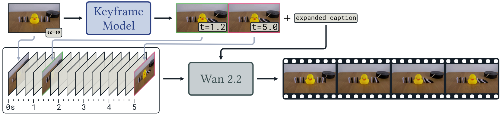
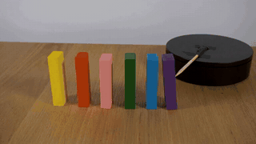
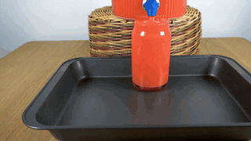
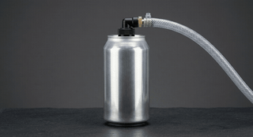
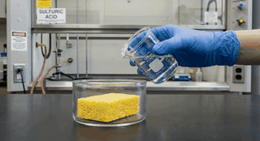

# K2V: Keyframes to Video

Video models are good at making things look right and poor at making them _happen_
right: a ball that should knock a duck over rolls past it, acid poured on a sponge does
nothing. **K2V** separates the two. A planning agent first works out what physically
happens and draws it as a small stack of **keyframes** — photographs of the scene at the
moments that matter — together with a detailed caption. The video model then generates
the clip **conditioned on those keyframes**, so the outcome is carried in pixels rather
than left to the text.

K2V runs on [Wan2.2](https://github.com/Wan-Video/Wan2.2) (I2V-A14B or TI2V-5B) with no
fine-tuning, from an image and a caption or from a caption alone.



<!-- TODO: replace assets/method.png with the method figure -->

## Results

|              Block dominoes              |               Liquid overfill               |        Can under vacuum         |        Acid on a sponge         |
| :--------------------------------------: | :-----------------------------------------: | :-----------------------------: | :-----------------------------: |
|  |  |  |  |
|              image to video              |               image to video                |          text to video          |          text to video          |

Image-to-video examples continue from a [Physics-IQ Verified](https://huggingface.co/datasets/Anates-Labs-Research/Physics-IQ-Verified)
starting frame. Text-to-video examples start from a [PhyGenBench](https://github.com/OpenGVLab/PhyGenBench)
prompt alone: _"A timelapse of air being gradually and forcefully pulled out of an empty,
thin, sealed aluminium can"_ and _"A timelapse captures the reaction as concentrated
sulfuric acid is poured onto a sponge"_.

## Install

K2V is designed to drop into an existing Wan2.2 environment: on top of Wan's own
requirements it needs only the Gemini SDK.

```bash
git clone --recursive https://github.com/felixomahony/k2v.git && cd k2v
# in your Wan2.2 environment (or a fresh one: pip install -r third_party/Wan2.2/requirements.txt)
pip install -e .
export GEMINI_API_KEY=...          # https://aistudio.google.com/apikey
```

Download the Wan2.2 checkpoint(s) you want, as in
[Wan2.2's instructions](https://github.com/Wan-Video/Wan2.2#model-download):

```bash
huggingface-cli download Wan-AI/Wan2.2-I2V-A14B --local-dir third_party/Wan2.2/Wan2.2-I2V-A14B
huggingface-cli download Wan-AI/Wan2.2-TI2V-5B  --local-dir third_party/Wan2.2/Wan2.2-TI2V-5B
```

**Already have Wan2.2?** Skip the submodule and point K2V at your checkout:
`--wan-dir /path/to/Wan2.2` (or `export K2V_WAN_DIR=...`). Checkpoints are looked for
inside it (`Wan2.2-I2V-A14B/`, `Wan2.2-TI2V-5B/`); use `--ckpt-dir` if they live elsewhere.

## Usage

```bash
# image to video
k2v --image examples/ball_and_duck.jpg \
    --caption "A tennis ball rolls out of the black pipe across the table and hits the rubber duck."

# text to video: the agent draws the opening frame itself
k2v --caption "A glass of water is knocked off a table edge and shatters on a tiled floor."

# the smaller backbone
k2v --model 5B --image examples/ball_and_duck.jpg --caption "..."
```

Or from Python:

```python
from k2v import run
video = run("A tennis ball rolls out of the pipe and hits the duck.",
            image="examples/ball_and_duck.jpg", model="14B", out="outputs/duck")
```

Each run writes to `--out` (default `outputs/k2v/`):

|                 |                                                                                    |
| --------------- | ---------------------------------------------------------------------------------- |
| `video.mp4`     | the result, colour-corrected                                                       |
| `video_raw.mp4` | Wan's output before colour correction                                              |
| `plan.json`     | the expanded caption, the keyframes (time, image, held) and the agent's transcript |
| `keyframes/`    | every render the agent made, raw and colour-matched                                |

| Option                    | Default   |                                                    |
| ------------------------- | --------- | -------------------------------------------------- |
| `--image`                 | none      | first frame; omit for text-to-video                |
| `--model`                 | `14B`     | `14B` (I2V-A14B) or `5B` (TI2V-5B)                 |
| `--seed`                  | 42        | diffusion seed                                     |
| `--wan-dir`, `--ckpt-dir` | submodule | an existing Wan2.2 checkout / checkpoint directory |
| `--no-colour-correction`  | off       | skip the final re-grade                            |

## How it works

Everything is in [`k2v/main.py`](k2v/main.py):

```python
planner = KeyframePlanner(GeminiLanguage(), GeminiImage(), out_dir=out)
plan = planner.plan(caption, image)                    # keyframe stack + expanded caption
wan = Wan(model, wan_dir=wan_dir, ckpt_dir=ckpt_dir)
video = wan.generate(plan.first_frame, plan.caption, plan.keyframes, seed=seed, ...)
video = regrade_video(video, ...)                      # re-grade each frame onto frame 0
```

1. **Plan** ([`planner.py`](k2v/planner.py)). An agent (Gemini 3.8 Flash) reads the
   caption and the first frame and builds a stack of keyframes. It edits the picture on
   top of the stack with an image model (Gemini 3.1 Flash Image), must say what each
   render actually shows before it can do anything else, and commits the renders it is
   satisfied with at times of its choosing. It has 24 turns and 8 renders, and finishes
   by writing the caption for the whole clip. Reusing an image at a later time says the
   scene is still between the two.
2. **Correct** ([`colour.py`](k2v/colour.py)). Image editors drift in colour, so each
   render is re-graded onto the first frame (a robust per-channel gain and offset) before
   it is used.
3. **Generate** ([`wan.py`](k2v/wan.py)). Wan2.2 is conditioned on the keyframes as well
   as the first frame. On the 14B each keyframe is written into the conditioning clip at
   its frame and marked in the mask
   ([`conditioning_14b.py`](k2v/conditioning_14b.py)); on the 5B the keyframe's latent is
   held fixed during denoising ([`conditioning_5b.py`](k2v/conditioning_5b.py)). A span
   the agent marked as still is conditioned as still every second.
4. **Re-grade** the finished video onto its first frame.

## Hardware and cost

Measured on one RTX PRO 6000 (96 GB):

- **14B**: 1280×720, 81 frames. Peak GPU memory ~77 GB, so an 80 GB card is the
  minimum; ~31 min of denoising, ~34 min end to end.
- **5B**: 1280×704, 121 frames, with model offloading. Peak GPU memory ~34 GB; ~4 min of
  denoising, ~8 min end to end including planning.
- **Planning**: at most 24 language-model turns and 8 image edits per video.

## Using other models

The planner needs two methods, defined in [`k2v/models.py`](k2v/models.py):

```python
class LanguageModel(Protocol):
    def converse(self, turns, tools, *, force=None) -> ToolCall: ...
class ImageModel(Protocol):
    def edit(self, instruction, images, out_path) -> Path: ...
```

Implement them for your provider and pass the instances to `KeyframePlanner`.
[`k2v/gemini.py`](k2v/gemini.py) is the reference implementation.

## Tests

```bash
pip install -e ".[test]" && pytest
```

The tests run on CPU and need neither a GPU, an API key nor a checkpoint.

## Citation

```bibtex
@inproceedings{k2v,
  title  = {K2V: Keyframes to Video},
  author = {TODO},
  year   = {2026},
}
```

## Acknowledgements

Built on [Wan2.2](https://github.com/Wan-Video/Wan2.2) (Apache-2.0), included as a
submodule. Example frames are from [Physics-IQ Verified](https://huggingface.co/datasets/Anates-Labs-Research/Physics-IQ-Verified)
(CC-BY-4.0); text-to-video prompts are from [PhyGenBench](https://github.com/OpenGVLab/PhyGenBench).

## License

Apache-2.0. See [LICENSE](LICENSE).
